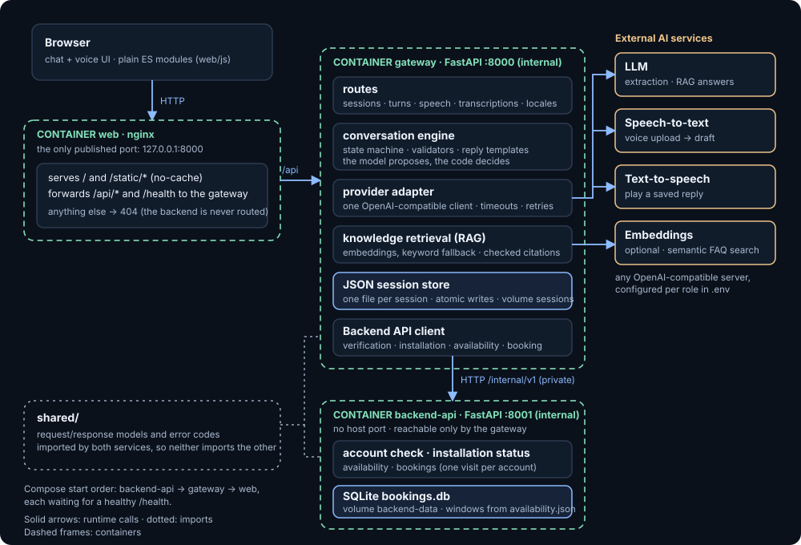

# Northstar Energy Customer Support

A conversational support assistant for a fictional energy provider, built for the
Core Engineer assignment. It interviews a customer about a service problem,
extracts and validates four fields, asks the customer to confirm, and saves the
result as JSON with a summary. It also answers energy questions from a small
knowledge base (RAG) with citations, and works by text or voice.

It is a **demo**: it never contacts a real support team, and the account data and
knowledge base are invented.

## Fictional scenario

A customer reports a damaged electricity meter, asks what a standing charge covers,
reviews the captured issue, and confirms it. The assistant answers the policy
question from the bundled knowledge base with a citation, then saves the confirmed
support request locally. The knowledge base is **not real energy-provider policy**.

## Quick start

You need Docker with Compose v2 and access to an LLM, a speech-to-text (STT) and a
text-to-speech (TTS) service that speak the OpenAI-compatible API.

```bash
cp .env.example .env        # then fill in the endpoints, models and keys
docker compose up --build -d --wait --wait-timeout 120
```

Open http://127.0.0.1:8000. To try the verified-account flow, use the demo values
shown in the "Test customer" card beside the chat (fictional account `NS-000123`,
postcode `SW1A 1AA`, code `246810`; phones see the same values in the verification
form), then ask for the installation status or to book a technician. The request
you made before verifying is answered as soon as the account is verified, even if
you typed only the account number in between. Stop with
`docker compose down`; add `--volumes` to also delete saved sessions and bookings.

## How it meets the assignment

| Requirement | Where |
|---|---|
| Natural conversation, one question at a time, several answers per message | `gateway/conversation/engine.py`, `gateway/providers/prompts.py` |
| Collect order/account reference, category, description, urgency | `gateway/conversation/validation.py`, `gateway/schemas.py` |
| Extract and validate into structured output | LLM extraction with strict schema, then deterministic validators |
| Error handling and edge cases | Bounded retries, clear error codes, state never changes on a failed turn |
| Conversation context | Saved transcript plus accepted fields; sessions resume after a restart |
| JSON storage and summary | `gateway/storage.py`, [`examples/session.example.json`](examples/session.example.json) |
| Speech-to-text and text-to-speech | Upload or record audio, edit the transcript, play replies (`gateway/providers/`) |
| RAG | Embedding retrieval (keyword matching if no embedding model is set) over `gateway/knowledge/northstar-faq.json`, validated citations, abstention |
| Account actions (extra) | After verifying the demo account: installation status and booking a technician (`backend_api/`, `gateway/conversation/visits.py`) |
| Sentiment (bonus) | The extraction call also labels sentiment and frustration; clear frustration hands off to a simulated agent |
| Multiple languages (bonus) | English and Spanish |
| Multi-turn memory (bonus) | Within a session |

## Models used

All three services are configured independently in `.env`; nothing is hard-coded.

| Role | Model | Why |
|---|---|---|
| LLM (extraction, RAG answers) | `DeepSeek-V4.1-Flash-1017`, self-hosted, JSON via `prompt_json` | Fast and cheap enough for one call per turn; no provider-side structured output needed |
| Speech-to-text | `whisper-large-v3-turbo` on Groq | Low latency |
| Text-to-speech | `canopylabs/orpheus-v1-english` on Groq, voice `troy`, WAV | Natural voice; replies are chunked and joined |
| Embeddings (optional) | `nvidia/nemotron-3-embed-1b:free` on OpenRouter (`EMBED_*`); any OpenAI-compatible `/v1/embeddings` model works | Semantic FAQ retrieval, handles Spanish; free tier, so rate-limited |

`scripts/check_backends.py` ran against these services on 2026-10-24 and passed all
five calls (extraction, supported and unsupported RAG questions, transcription,
synthesis), at roughly 0.5–1.7 s each.

## Architecture



The same diagram, with the request flow, is in [`docs/architecture.html`](docs/architecture.html).

The page and each service live in their own folder, with their own Dockerfile:

```
web/           the chat page (index.html, css/, js/) and the nginx config that serves it
gateway/       chat service   routes/  conversation/  providers/  knowledge/  locales/
backend_api/   Backend API    main.py  bookings.py  availability.json
shared/        the models and error codes both services use
tests/         unit/{gateway,backend_api,tooling}  integration/  e2e/  js/
```

Docker runs three containers: `web` (nginx, the only published port: it serves the page and forwards `/api` and `/health` to the gateway), `gateway`, and the private `backend-api`. The gateway and the Backend API import only `shared/`, never each other.

- `gateway/conversation/engine.py` is the turn transaction and state machine (`collecting` → `awaiting_confirmation` → `completed`); `intent.py`, `plans.py` and `replay.py` decide what an extraction means, what to reply and how duplicates are handled.
- `gateway/providers/client.py` is one OpenAI-compatible adapter for every role, with timeouts, retries and a concurrency limit.
- `backend_api/` is the only place that holds account data: the account check, installation status, technician windows (hours and days are edited in `availability.json`) and bookings, kept in one SQLite file. The gateway reaches it over the internal network only.
- `web/` is the chat page with no build step: plain ES modules, one class per concern, everything injected so tests replace the network and microphone. CSS follows OOCSS: `objects.css` structure, `skins.css` colour, `base.css` tokens. The chat is one centred column, 720 px wide at most (the whole screen on a phone). Four quick-option buttons (report a problem, ask a question, installation status, book a technician) show under the greeting and under the "what I can do" reply, so a customer can start without typing; they send a ready-made message through the normal turn and disappear once the conversation moves on. After a saved request the receipt ends with "Is there anything else I can help with?" and the buttons return; pressing one opens a new conversation and sends that option. A hand-off or the gas-safety answer asks nothing, since the customer has something else to do.

## Key design decisions

- **The model proposes, the code decides.** The LLM only extracts candidate facts and intent. Application code owns validation, state, the next question and completion, so a model mistake or prompt injection cannot save bad data or trigger actions.
- **Deterministic replies and summary.** Questions, the review and the summary come from templates, so the saved record matches what the customer confirmed. Only RAG answers are generated.
- **Safety comes first.** "I smell gas" is a statement, so the intent label can send it to intake. Two independent checks run before intake, and either one is enough: the model's `safety_concern` flag, and an embedding check that asks whether the message is closer to a labelled emergency example or to an ordinary one. The examples are plain sentences in [`gateway/knowledge/safety-examples.json`](gateway/knowledge/safety-examples.json), so teaching it new wording means adding a sentence, not code. The embedding check runs beside the model call and still works when the model is down. The customer gets the gas-safety record at once (if the model is down, the record text as written), and a gas report wins over the angry-customer hand-off.
- **Explicit confirmation.** Nothing is saved as submitted until the customer confirms a specific review; a correction invalidates it.
- **Safe failure.** A failed model call, write or invalid answer leaves the session untouched and can be retried; repeated requests are de-duplicated.
- **Simple storage.** One JSON file per session with atomic replacement, as the assignment asks. Technician bookings live in one SQLite file (standard library, no server); the database itself stops two customers taking the same window or one account holding two visits. No vector store.
- **Grounded answers.** The assistant answers only from retrieved records, cites them, and says when it has no information. Citations are built by the app, never taken from the model.
- **Provider-agnostic.** Any OpenAI-compatible server can fill any role.

## Example session

[`examples/session.example.json`](examples/session.example.json) is a sanitized,
hand-written example: a greeting, one intake turn, one cited policy answer, the
confirmation and the completed summary.

## Voice

Upload a WAV file or record in the page. The audio is checked (PCM WAV, up to 60 s
and 10 MB) before transcription. The transcript appears as an editable draft and is
only sent when the customer presses send. Each assistant reply has an optional play
button. Audio is never stored.

## Knowledge base

The fictional corpus has twelve records. Retrieval depends on configuration:

- **Embeddings** (when `EMBED_*` is set): records are embedded once and each question
  is matched by cosine similarity. The best two records at or above
  `EMBED_MIN_SIMILARITY` go to the model; if none qualifies the assistant abstains. If
  the embedding service fails, that question falls back to keywords.
- **Keywords** (default): records are scored by the words they share with the question.

Either way the model only sees the retrieved records, and the app checks the citations
(`gateway/knowledge/`).

Records:
`faq-delivery` Delivery times ·
`faq-damaged` Damaged items ·
`faq-returns` Returns and refunds ·
`faq-urgency` Urgency levels ·
`faq-standing-charge` Standing charges on an energy bill ·
`faq-installation` Smart meter installation ·
`faq-meter-readings` Submitting a meter reading ·
`faq-moving-home` Moving home ·
`faq-bill-queries` Questions about your statement ·
`faq-power-cut` Power cuts and loss of supply ·
`faq-gas-safety` If you smell gas ·
`faq-account-reference` Finding your account reference

## Testing

```bash
pip install -r requirements-dev.txt
python -m ruff check gateway backend_api shared
python scripts/test.py unit          # also: integration, e2e, coverage, mutation, all
python scripts/check_backends.py     # live check against the services in your environment
npm ci && npm test                   # frontend unit tests (Jest)
```

| Layer | What it covers | Result (2026-10-25) |
|---|---|---|
| Unit and integration | Validation, state machine, storage, HTTP routes, providers over a real socket, RAG, audio | 1816 unit and 394 integration passed, run as separate layers. Two wall-clock timeout tests can fail when both share one pytest process on a slow machine. |
| Browser (Playwright) | Eleven Chromium tests of the user journeys, including voice and RAG | 11 passed |
| Frontend (Jest) | The page's classes in jsdom, using the real `index.html` | 303 passed; 97.8% statements, 92% branches (CI gate 90% / 80%) |
| Judge journeys | 31 browser tests with a scripted provider; 29 record a conversation that a judge LLM grades against a written rule. Every intent, including verification before account actions, and frustration hand-off | 31 passed; 29 of 29 judged pass. Replies are mostly templates, so this checks wording rules, not model behaviour. |
| Real Docker end-to-end | 15 tests on the deployed containers against the real LLM, speech services and embeddings, graded by the judge LLM: every intent, a full intake, RAG with abstention, account actions, angry and nervous customers in both languages | 15 passed, with the same DeepSeek model as judge, so it grades itself. The booking test uses the demo account's one visit; reset with `docker compose down --volumes`. A reasoning judge needs `E2E_JUDGE_MAX_TOKENS=4096`. |
| Live providers | `scripts/check_backends.py` | 5 of 5 (2026-10-24) |
| Mutation testing | `mutmut` over `gateway/`, `backend_api/` and `shared/`, Linux only, in CI | Not re-run since the package split. An earlier run killed 2563 of 2677 mutants; the rest were reviewed as equivalent. |

## Evaluation

The scripted tests prove what the app does once it knows the intent. They cannot show
whether the real model picks the right intent or FAQ record, so an operator-run
evaluation checks that against the live services (not part of the automatic run):

```bash
python scripts/evaluate.py            # also: intents, category, safety, frustration, retrieval
```

It uses the labelled utterances in [`tests/eval/utterances.json`](tests/eval/utterances.json)
(99 English and Spanish messages, plus two FAQ question sets). Run on 2026-10-25 with
`DeepSeek-V4.1-Flash-1017` and `nvidia/nemotron-3-embed-1b:free`.

**Intent detection: 85 of 89 at first, 89 of 89 after a prompt-only fix.** The misses
were "I want to report a problem" (and its Spanish and "Let me report a fault"
variants) read as `provide_details`, and "What are the urgency levels?" read as
`capability`. The fix was two prompt rules and three new examples worded differently
from the test messages. The 89 are the messages that exposed the misses, so read 100%
as a regression baseline, not general accuracy.

Manual tests later showed "help me with something" and "I have a problem" being sent to intake, which asked for an account reference before the customer had said what they wanted. Saying only that there is a problem, or asking for help, is now a `capability` turn: the reply lists what the assistant can do and asks what the customer needs. An explicit request to report, raise or log a problem still starts an intake. Ten such messages joined the set, and the score on the live model is 99 of 99 (the explicit report requests are still 8 of 8).

**Safety triage (gas): each check alone, and both together, caught 15 of 15 gas reports with 0 false alarms on 14 look-alikes and 0 on 99 everyday messages.** The set has English and Spanish, indirect wording ("smells like rotten eggs", "hissing by the meter", a carbon monoxide alarm) and look-alikes (a high gas bill, a gas meter installation, "I smelled new paint"). Recall is the number that matters, since a false alarm only shows safety advice. The first run of the embedding check raised one false alarm ("How's it going?"); adding two greeting sentences to the examples file fixed it with no code change. The examples share nothing with the evaluation messages (a test enforces that). The messages were written by one author and 29 is a small set: read it as a check that both work, not as a guarantee. Adding the safety checks did not move the other scores (intents still 99 of 99, hand-off 9 of 9 and 8 of 8).

**Support area (what the stored category should be): 8 of 27 at first, 27 of 27 after a prompt-only fix.** A manual test showed "i have overcharged in my last bill" saved as "other energy issue". The prompt named the category codes but never said what they meant, so the model put almost everything under `other`: bills, power cuts, wrong readings and broken equipment alike. The fix is one prompt sentence that defines each area (supply, equipment, meter reading, billing, other) and says to leave the category empty when the message does not make it clear. The 27 messages (English and Spanish, five or more per area) were written before the fix; run `python scripts/evaluate.py category`.

**Frustration hand-off: 9 of 9 angry messages handed off, 8 of 8 calm or nervous kept.**
The messages were written by one author and judged one at a time, so milder or
sarcastic complaints may differ. The Docker tests cover it end to end.

**FAQ retrieval.** The *tuning set* chose the similarity floor, so its scores are
optimistic. The *held-out set* was run once at the chosen floor; its first ten
questions were written before any score was seen, the last seven were added with the
new records they test.

| Retrieval | Tuning: right record | Tuning: correctly no answer | Held-out: right record | Held-out: correctly no answer |
|---|---|---|---|---|
| 5 records, keywords | 11 of 13 | 4 of 5 | 3 of 10 | 5 of 5 |
| 5 records, embeddings (floor 0.25) | 12 of 13 | 5 of 5 | 9 of 10 | 5 of 5 |
| 12 records, keywords | 21 of 21 | 3 of 4 | 12 of 17 | 5 of 5 |
| 12 records, embeddings (floor 0.25) | 21 of 21 | 4 of 4 | 17 of 17 | 5 of 5 |

On fresh wordings keywords collapse ("I want my money back" shares no keyword with the
records) while embeddings still find the record, and keywords wrongly answered "Do you
ship internationally?" with the delivery record. The 12-record corpus rewrote the shop
sounding records in energy terms and added seven new ones; the floor was not retuned.
Some held-out misses were fixed after being seen, so that gain is partly by
construction, and the questions are few and written by the records' author.

The floor of 0.25 was chosen on the tuning set (0.35 dropped correct paraphrases, 0.20
let "Do you ship internationally?" through), so treat it as a sensible value for this
model, not an optimum; re-run `scripts/evaluate.py retrieval` if the model changes.
Of four free OpenRouter embedding models tried, three tied and the 8B one timed out,
so the first was kept.

## Limitations

- **Single process, one worker.** Locks and de-duplication are in memory.
- **No authentication.** Session IDs are not credentials. It is for local only use; a public deployment would need authentication, rate limiting, TLS and a retention policy.
- Nothing is sent to a real support team; "submitted" means saved locally.
- The receipt shows a short reference (`REQ-` and the first eight characters of the session id, for example `REQ-2B0737BE`), not the full id. The session file is named after the full id, so the reference is enough to find it, but eight characters are not unique at scale.
- Answers come from twelve short fictional records. Keyword matching can miss a differently worded question; embedding retrieval depends on `EMBED_MIN_SIMILARITY`, tuned for one model on a small set. The gas-safety record quotes the UK National Gas Emergency number from memory; check it before relying on it. A citation shows which record was used, not that the model summarised it correctly.
- Bookings (SQLite): one visit per account, no cancelling or rescheduling, and the offered times disappear if the page is reloaded (ask again).
- Only gas (a smell, a leak or a carbon monoxide alarm) gets the immediate safety answer. Other emergencies (sparks, smoke) are not in the knowledge base, so the assistant treats them like any other message. Both checks can miss: the model's flag, and the embedding check, which needs the embedding service and is switched off when none is configured (the model's flag alone then applies). Both were measured on 29 messages (see Evaluation).
- Voice accepts PCM WAV only, with no streaming.
- Frustration and sentiment come from one LLM call and can misread sarcasm or mixed feelings.
- Stored category values are older identifiers (`delivery`, `damaged_item`, `wrong_item`, `return_refund`, `other`) that the UI shows as supply, equipment, meter, billing and other.
- Audio and messages go to the configured providers; check their retention policies before using real customer data.

## Potential improvements

- Authenticated sessions and a shared database, so it can run with several workers.
- A vector store and chunking for a larger knowledge base (embeddings are held in memory today).
- Streaming voice and barge-in.
- Rename the stored category values to the energy vocabulary, with a migration.
- Cross-session memory with identity and consent.
- Order the quick-option buttons by the most common intents in the last 10 minutes, so the page offers what customers are asking for right now.
- A live ticketing handoff instead of the simulated one.

## Demo video

Demo video: pending
